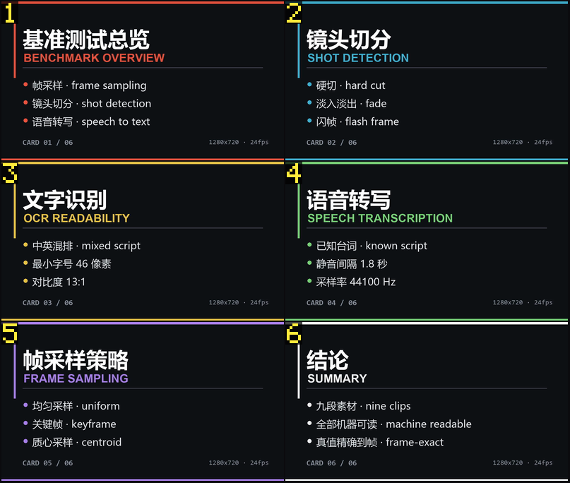
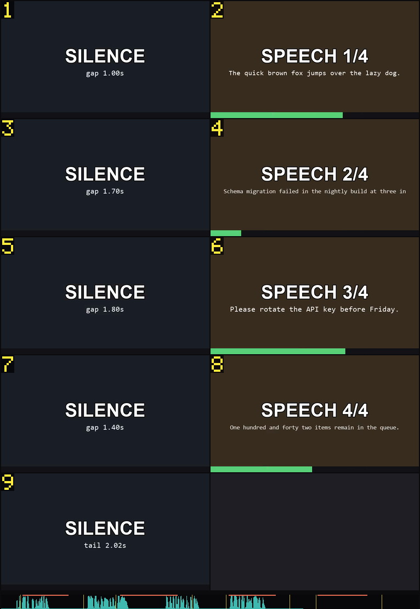
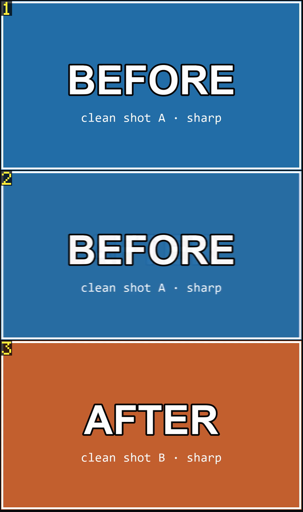

# dsh-video-vision

让模型**看**视频，而不是听人转述视频。每次调用给出一张**可寻址的分镜图**（
storyboard grid），为 `deepseek-v4.1-flash` 的视觉能力调优。可直接替换
`dsh-video-storyboard` / `dsh-video-understand`：三个工具名一致、参数一致，引擎不同。

```
video_probe       读容器元数据 + 阅读计划，不解码画面
video_storyboard  一张分镜图 + 逐格对应的文本索引
video_zoom        对一个短窗口放大看，1-9 格
video_read        整条视频读成带时间戳的文本 —— 讲课、幻灯片、录屏

输入可以是文件路径、直链，或 **B站 链接**（`bilibili.com/video/BV…`、裸 BV 号、`av` 号、
`b23.tv` 短链）：第一次会下载到缓存，之后和被下载好的文件一样读。
```

> 每一项设计决定背后的实测数据见 [docs/DESIGN.md](docs/DESIGN.md)；
> 逐片段实测、误差说明与复现方式见 [docs/EVIDENCE.md](docs/EVIDENCE.md)。

<table>
<tr>
<td width="50%"><br>
<em>D 片段：六张只有文字块不同的卡片，六格 / 359 token，每一条项目符号都清晰可读。</em></td>
<td width="50%"><br>
<em>G 片段：九格 + 音频带 —— 青色包络、橙色说话区间、黄色切点刻度。一张图 542 token。</em></td>
</tr>
<tr>
<td colspan="2"><br>
<em><code>video_zoom</code> 看一个 1 秒叠化：前、过渡中、后，三格大图。</em></td>
</tr>
</table>

---

## 好在哪

**能看见「亮度相同」的切点。** 每个画面被压成 12x7 的**亮度块 + 色度块**，
一次 ffmpeg 解码同时算出。两个镜头亮度几乎一样、只是调色不同时，只看得见亮度的
检测器会认为「什么都没发生」，这里不会。跳变被分成五类：`cut`（真切）、
`partial`（幻灯片只有文字块变了）、`overlay`（字幕/贴图出现）、`light`（开灯）、
`noise`；只有前两类会变成格子。

**闪光和转场不算新镜头。** 单帧白闪会在 3 帧内恢复原画面，直接丢弃；渐变（disolive）
被识别为**瞬态**——一段变化的平台期，之后必须安静下来——因此只产生一个边界，
而不是一串碎镜头；而缓慢摇镜不会产生任何边界。

**图按「每格」定尺寸，不按「整张」定。** 宿主按面积计费
（`tokens = gridH*(gridW+1)+2`，上限 1024）。1.25 Mpx 的图里放 10 格和放 4 格
**同价**，所以预算用来换「更多时刻、更小的格」，直到格子看不清为止：
6 格约 350 token，20 格约 1000 token，内容少的片子自然就便宜。

**格子是挣来的，不是平均分的。** 每个镜头保底一格；额外格子只给「时长够长」且
「存在一帧与已选帧的距离超过同图阈值 2.5 倍」的镜头。静态口播永远拿不到第二格，
30 秒摇镜会分到 4 格。

**没有切点的长段，按"变化"给格。** 讲课、录屏、写板书：十一分钟只有一个镜头，而
要看懂恰恰靠"每分钟多出了什么"。超过 90 秒的段，判据从"这两张图差多远"换成"画面
里有没有新的东西"——同样在 12×7 的块网格上算，一次变化一格，最多每 30 秒一格、
整段不超过 24 格。19 分钟的时间窗从 4 格变成 22 格，分镜图预算仍是 1 024 token。

**解码是批量的。** 6 格共用**一个** ffmpeg 进程（多个输入、各自输出），并发 3 个
进程——一张 20 格的图只启动 2-4 次进程，而不是 60 次。

**结果里不写废话。** 阅读说明放在工具描述里（属于可缓存的 prompt 前缀，只付一次），
结果本身只包含索引和那张图。`textOnly` + `cellRange` 可以零图像成本翻页，
重复调用命中缓存。

---

## 数据

9 个片段，逐帧精确的标准答案，同一台机器，直接以模块方式驱动
（`bench/final.mjs`）。完整协议、逐片段表格与结论的适用边界见
[docs/EVIDENCE.md](docs/EVIDENCE.md)。

| | 数值 |
| --- | --- |
| 耗时（冷启动） | **634 ms**（多次运行 581-648 ms） |
| 耗时（命中缓存） | **411 ms**（370-411 ms） |
| 给出的时刻数 | **67 格** |
| 视觉 token | 3 648 |
| 每个被展示时刻的 token | **54.5** |
| 切点 F1（micro，0.5 秒） | **0.872** |
| 切点召回 / 精确率 | 1.000 / 0.774 |
| 镜头覆盖率 | **0.963** |
| 结果里的说明文字 | 477 字符 |
| 两小时课程读成文本 | **91 秒**，56 屏，7600 字 |
| 36 秒文字卡片 | **1.1 秒**，6 屏 |
| B站 链接只探测（不下载） | **226 毫秒** |

对一部 **13 分钟** 的片子，一次调用给**一张**图：28 格、每格 331x186、
1024 token、6.2 秒，连同索引共约 1353 token 的上下文。完整表格在 EVIDENCE.md。

弱项写在上面那张文件里，不四舍五入：1 秒叠化会被判成一次渐变边界，而标准答案
认为该片段「没有切点」，所以这里记一次误报；语料里还有两个片段整帧换画面
（章节卡、音乐段落），会被判成切点。真实视频的抽检与实际可读性截图：
[docs/REAL-WORLD.md](docs/REAL-WORLD.md)。

---

## 安装

插件**零运行时依赖**。需要 `ffmpeg`；有 `ffprobe` 时用它，没有就从 `ffmpeg -i`
的输出里解析元数据。

```bash
cd /path/to/dsh-video-vision
node bin/install.mjs            # 改 ~/.dsh/profiles/desktop，然后重启 DSH
node bin/install.mjs --dry-run  # 只打印要改什么，不动文件
node bin/install.mjs --remove   # 卸载
```

脚本手工做完了 `pnpm install` 本来会做的三件事：往 profile 的 `dependencies` 里写
`"dsh-video-vision": "link:<绝对路径>"`、把包名加进 `dsh.profile.bundles`、把包
**目录联接（junction）**到 profile 的 `node_modules`。可重复执行；`--copy` 改成
复制一份快照而不是链接。无论哪种方式，装完都要**重启应用**：包内的
`cordis.patch.yml` 在启动时把插件插入 harness 树，三个工具才会出现。

### ffmpeg 查找顺序

`$DSH_FFMPEG_PATH` → `$DSH_VIDEO_FFMPEG` → `$FFMPEG_PATH` → 包内 `vendor/bin` →
node_modules 里的 `ffmpeg-static` / `@ffmpeg-installer` → WinGet Links →
`C:\ffmpeg\bin` → scoop → npm roaming → `/usr/local/bin` →
`~/.dsh/dsh-runtimes/*/` 里的 `imageio-ffmpeg` → `PATH` 上的 `ffmpeg`。
ffprobe 同理（`$DSH_FFPROBE_PATH` / `$FFPROBE_PATH`）。

一条命令自检（不需要现成视频，它会自己生成一个）：

```bash
node bin/selfcheck.mjs --smoke          # 17 项检查，自己生成素材
node bin/selfcheck.mjs --smoke --host   # 32 项：用已安装的 Harness 自己的 schema 校验四个工具
                                        # 引擎校验三个工具（29 项）
node --test test/                       # 161 个单元测试，不联网，临时目录隔离
```

`--host` 跑的是 `ctx.tools.register` 真正执行的断言，然后逐个工具真调用一次，
再按运行时的规则校验返回值。要用 Electron 的 node 跑（`ELECTRON_RUN_AS_NODE=1`），
普通 node 读不进 `app.asar`。这不是形式主义：工具如果返回 `{ text: {…} }` 而不是
`{ text: "…" }`，宿主会直接拒绝并报 `"value.text" must be a string`，本地一切正常，
直到用户按下调用。

---

## 用法

```
video_storyboard input:"C:\clips\pv.mp4"
```

```
pv.mp4 · 0:00:40.00 · 1280x720 · 30fps · 9 cuts · median shot 4.00s
sheet 1 · 2x5 grid · 942x1328 · 10 cells · window 00:00.00-00:40.00
cols: cell · pos · span · (cuts) · frame@
1 r1c1 00:00.00-00:04.00 @00:01.98
2 r1c2 00:04.00-00:07.68 @00:05.85
...
audio: speech 42% · -18.2 dBFS · loudest 0:41.20 · 3 silences · 12 onsets
transcript: subtitle-track · 18 segments
```

图片在同一个工具结果里返回。`r2c1` = 从上往下第 2 行、从左往右第 1 列；格子左上角
烧进去的数字就是格号。

| 参数 | 含义 |
| --- | --- |
| `input` | 文件路径，或 ffmpeg 能直接抓取的 `http(s)` 媒体地址 |
| `start` / `end` / `duration` | 只看一个窗口 |
| `detail` | `low`（≤6 格）· `auto`（≤20，默认）· `high`（≤28） |
| `cells` | 强制格数（1-24） |
| `pick` | `sharp`（默认）/ `middle` |
| `textOnly` | 只返回文本索引：不取图、不解码 |
| `cellRange` | 配合 `textOnly`，列出第 a 到第 b 格 |

`video_zoom` 支持同样的窗口参数，外加 `cells`（1-9）与 `at`；只有 1 格时返回原分辨率单帧。

### 读一堂课

```
video_read input:"C:\clips\lecture.mp4"
```

```
# lecture.mp4 — read as text · 56 screens · 975 keyframes · 112 s

## outline
00:45 例题1
17:20 例题3

[00:45–01:29] 1 归纳推理 … 1.1 归纳证明 …
```

只解**关键帧**（`-skip_frame nokey`，比整片解码快约 6 倍），按画面变化聚类，每类只 OCR 一次，
再把说的是同一件事的屏合并（字符二元组相似度，因为 OCR 噪声让精确比对失效）。
丢掉的是录屏软件，不是课：标签栏是贴着上边缘的短行，状态栏是贴着下边缘的短行，聊天面板是一屏全是极短的行，
老师手写的那些帧只会识别成一堆两个字的碎片、没有一句完整的话。这几个判据都是几何位置，跟是哪个软件录的无关。

实测一条 1 小时 59 分的 2K 课件：**112 秒**、975 个关键帧 → 388 类 → **56 屏、1.01 万字**，十一道例题全在目录里；
15 分钟窗口 **16 秒**，36 秒短片 **1.4 秒**；
同一条片子走 `video_storyboard` 要 163 秒，且返回的 1024 token 分镜图看不清幻灯片上的字。

OCR 用 Windows 自带引擎（无需下载、无需模型）；其它平台会直接说明不可用，回落到分镜。

---

### 语音转文字（自带引擎时）

如果把 `DSH_ASR_CMD` 指向一个你信得过的引擎，`video_storyboard` 和 `video_read`
会把**说的话**也引出来，不只是字：

```
set DSH_ASR_CMD=C:\python\python.exe F:sr\engine.py --model small {wav} {out}
```

插件只做三件事：把这一段的音频抽一次（16 kHz 单声道）、跑你的命令、解析它写到
`{out}`（或直接打到 stdout）的 SRT，再把每句话挂到"中点落在哪一格"的格子上——
一句只引一次。有字幕轨时永远优先用字幕：那是人写的，而且不用解码。

**故意不内置模型**：这个包 600 KB 代码、零依赖，而准度在模型里（tiny 75 MB、
small 484 MB、medium 1.5 GB）。同一段两分钟的真实课堂录音、16 线程实测：

| 引擎 | 转录耗时 | 两小时外推 | 读出来的样子 |
|---|---|---|---|
| `tiny` | 2.5 s | 约 2.5 分钟 | 乱：把"选法"听成"選抜" |
| `small` | 15.5 s | 约 15 分钟 | 可读，输出繁体，"递推"听成"地规" |

本机自带的离线识别也试过并放弃：`System.Speech` 中文把同一分钟变成一行 60 字、
置信度 **1.7 %** 的乱码——那种"有 ASR"比没有更糟，所以这里是钩子而不是功能。

分工因此是：课件、录屏走 `video_read`（两小时 87–112 秒），纯语音走 ASR，
两者都要时先读字，再用 `start`/`end` 对关心的那一段跑 ASR。

## 做不到什么

- **不内置语音识别。** 只有文件自带字幕轨，或者你按上面的方式配了 `DSH_ASR_CMD`
  时，才会逐格引用台词。两者都没有时，仍然给你音频摘要：说话占比、响度、静音、起音。
  不下载模型、不需要 key、不联网。
- **不带下载器。** 网页地址（YouTube、B 站）不做解析：那需要 `yt-dlp`，本插件
  既不自带也不调用它。请先下载成文件再传路径。直链 `http(s)` 媒体地址可以，
  由 ffmpeg 自己抓。
- **切点是检测出来的，不是理解出来的。** 快速甩镜和硬切在 96x54 的网格里可能相似，
  分类器在「变化很局部」时倾向于判「不是切点」。
- **它不是播放器。** 一次调用 = 一张最多 28 个瞬间的静态图。

---

## 致谢

本插件的起点是一个想法：一张画面上烧好格子编号的分镜图，配一份把格子与时间码
绑定的文本索引，而且不用任何图像库。这个想法来自
[SAOS-3624/dsh-video-storyboard](https://github.com/SAOS-3624/dsh-video-storyboard)，
那份文档也是「为什么这样做有效」最清楚的说明。谢谢。

这里是**独立实现**：没有复制它的代码，切点检测、格子预算、解码与合成方式都不同。
三个工具名、参数形状与清单语法是有意保持兼容的，这样在原插件已安装的地方可以直接
替换。归属声明见 [NOTICE](NOTICE)。

---

## 许可

MIT。ffmpeg 的许可见你指向的构建（GPL/LGPL）；本包不附带任何 ffmpeg 二进制。
